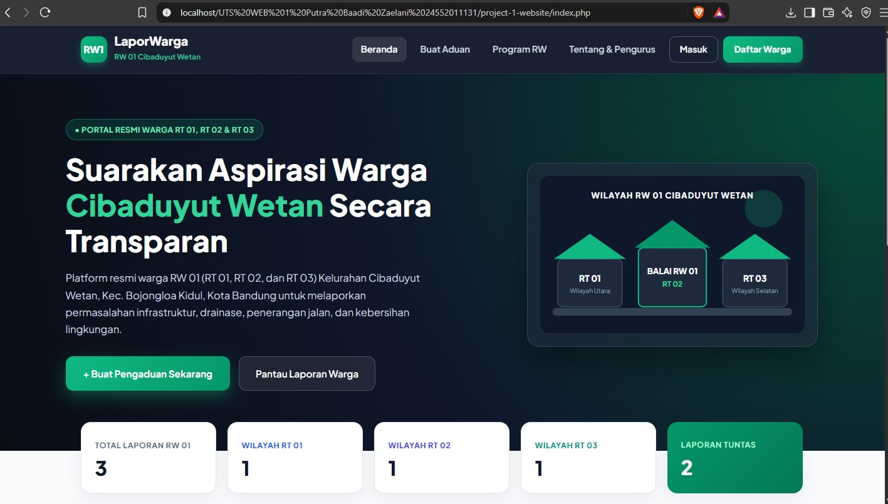
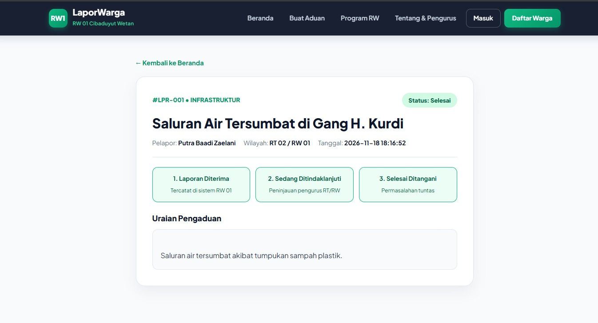
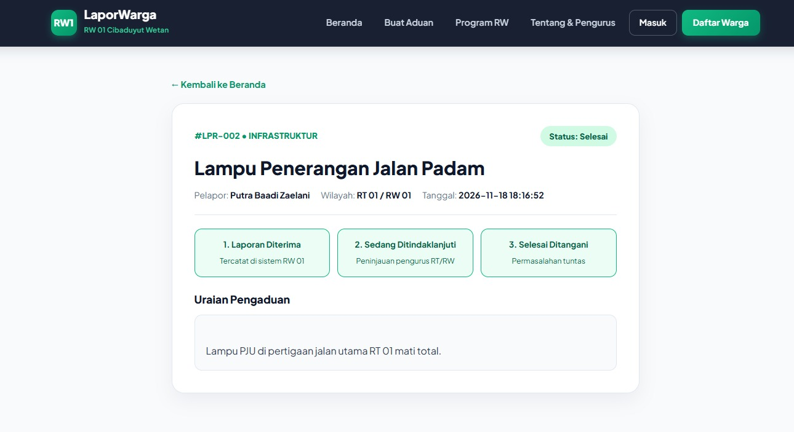
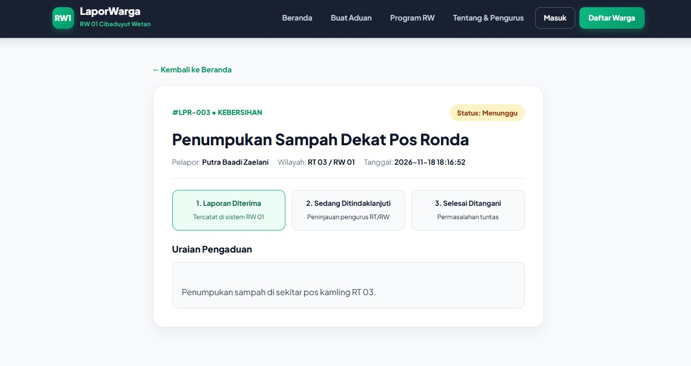
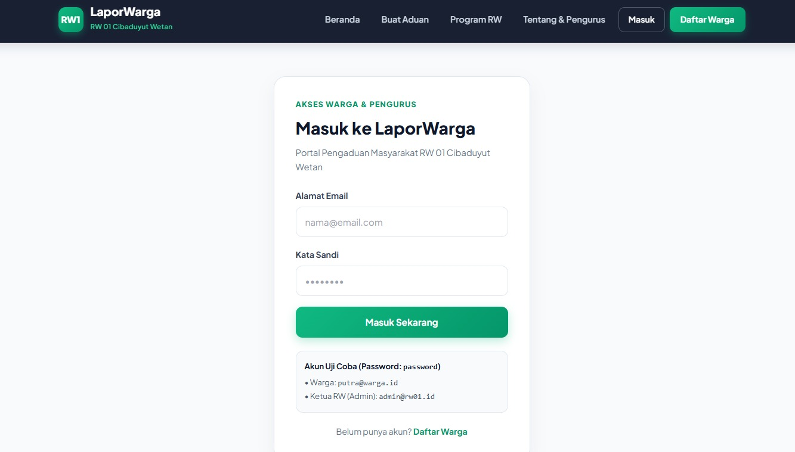
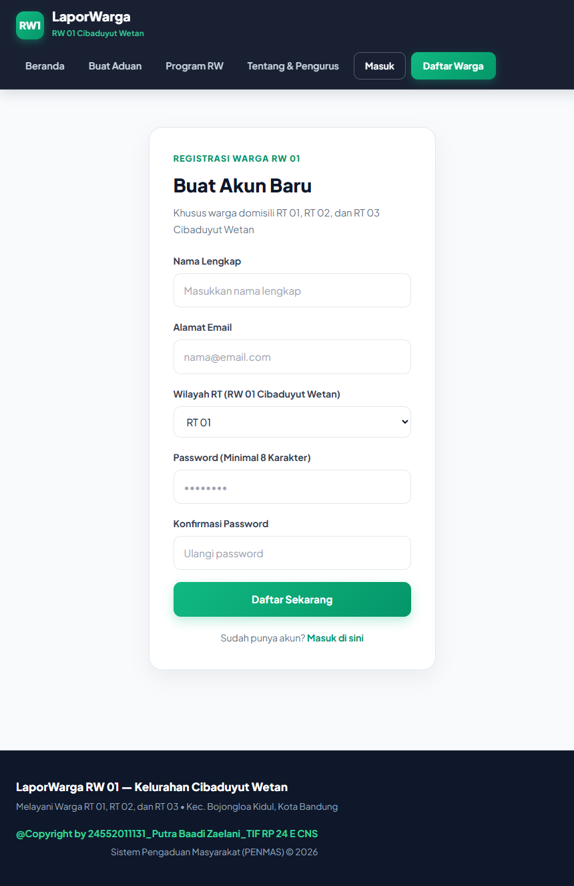
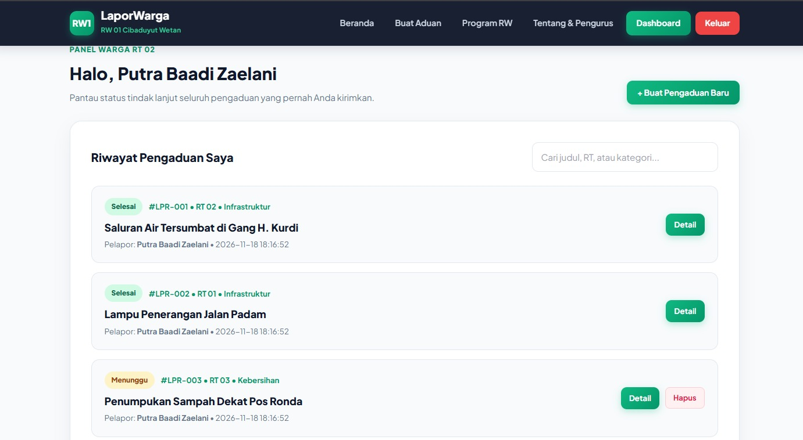

# LaporWarga RW 01

**Sistem Informasi Pengaduan Masyarakat RW 01 Kelurahan Cibaduyut Wetan**

LaporWarga merupakan sistem informasi berbasis web yang dikembangkan untuk membantu masyarakat dalam menyampaikan pengaduan terkait lingkungan dan pelayanan masyarakat. Sistem ini mencakup wilayah RT 01, RT 02, dan RT 03 di RW 01, Kelurahan Cibaduyut Wetan, Kecamatan Bojongloa Kidul, Kota Bandung.

Repository ini terdiri dari dua bagian utama, yaitu website berbasis PHP Native dan REST API CRUD yang menggunakan database MySQL yang sama.

## Teknologi yang Digunakan

- PHP Native
- MySQL / MariaDB
- MySQLi
- HTML5
- CSS3
- JavaScript
- Apache Web Server
- XAMPP / Laragon
- Postman untuk pengujian REST API

## Fitur Aplikasi

### Project 1 — Website LaporWarga

Website digunakan oleh masyarakat untuk menyampaikan dan memantau pengaduan.

Fitur yang tersedia:

- **Beranda:** halaman utama aplikasi LaporWarga.
- **Registrasi:** pendaftaran akun masyarakat.
- **Login:** autentikasi pengguna.
- **Dashboard:** halaman pengguna setelah berhasil login.
- **Pengaduan:** formulir untuk menyampaikan laporan masyarakat.
- **Detail Pengaduan:** menampilkan informasi laporan berdasarkan ID.
- **Program Kerja:** informasi program kerja lingkungan.
- **Tentang Kami:** informasi mengenai aplikasi LaporWarga.
- **Logout:** mengakhiri sesi pengguna.

### Project 2 — REST API

REST API digunakan untuk mengelola data pengaduan melalui format JSON.

Operasi API yang tersedia:

- **GET:** menampilkan seluruh laporan atau detail laporan.
- **POST:** menambahkan laporan baru.
- **PUT:** memperbarui status laporan.
- **DELETE:** menghapus laporan.

## Struktur Repository

Klik nama folder atau file untuk melihat isinya di GitHub.

**Repository utama:** [UTS-WEB1-Putra-Baadi-Zaelani-24552011131](https://github.com/Baadizlniii/UTS-WEB1-Putra-Baadi-Zaelani-24552011131)

```text
UTS-WEB1-Putra-Baadi-Zaelani-24552011131/
```

- [UTS WEB 1 Putra Baadi Zaelani 24552011131/](./)
  - **Project 1 — Website**
    - [project-1-website/](./project-1-website/)
      - [assets/](./project-1-website/assets/)
        - [css/](./project-1-website/assets/css/)
        - [js/](./project-1-website/assets/js/)
      - [config/](./project-1-website/config/)
        - [database.php](./project-1-website/config/database.php)
      - [includes/](./project-1-website/includes/)
        - [header.php](./project-1-website/includes/header.php)
        - [navbar.php](./project-1-website/includes/navbar.php)
        - [footer.php](./project-1-website/includes/footer.php)
      - [index.php](./project-1-website/index.php)
      - [detail.php](./project-1-website/detail.php)
      - [login.php](./project-1-website/login.php)
      - [register.php](./project-1-website/register.php)
      - [dashboard.php](./project-1-website/dashboard.php)
      - [pengaduan.php](./project-1-website/pengaduan.php)
      - [program.php](./project-1-website/program.php)
      - [tentang.php](./project-1-website/tentang.php)
      - [logout.php](./project-1-website/logout.php)

  - **Project 2 — REST API**
    - [project-2-api/](./project-2-api/)
      - [config/](./project-2-api/config/)
        - [database.php](./project-2-api/config/database.php)
      - [api/](./project-2-api/api/)
        - [laporan.php](./project-2-api/api/laporan.php)

  - **Dokumentasi Screenshot**
    - [screenshots/](./screenshots/)
      - [web/](./screenshots/web/)
      - [postman/](./screenshots/postman/)

  - [database.sql](./database.sql)
  - [README.md](./README.md)

## Database

Nama database yang digunakan:

`db_laporwarga`

Database terdiri dari dua tabel utama:

| Nama Tabel | Fungsi |
|---|---|
| `users` | Menyimpan data akun warga dan admin |
| `laporan` | Menyimpan data pengaduan masyarakat |

Relasi antartabel:

`users.id` → `laporan.user_id`

Setiap laporan terhubung dengan akun pengguna yang membuat laporan tersebut.

File database tersedia pada [database.sql](./database.sql).

Database dilengkapi dengan data contoh untuk membantu proses pengujian aplikasi.

## Instalasi Lokal dengan XAMPP atau Laragon

### 1. Persiapan

Pastikan perangkat sudah memiliki:

- XAMPP atau Laragon.
- PHP.
- MySQL atau MariaDB.
- Browser.

### 2. Menempatkan Folder Proyek

Salin folder proyek ke direktori web server.

**XAMPP:**

```text
C:\xampp\htdocs\
```

**Laragon:**

```text
C:\laragon\www\
```

### 3. Menjalankan Server

Aktifkan layanan:

- Apache
- MySQL

### 4. Membuat Database

1. Buka phpMyAdmin melalui `http://localhost/phpmyadmin`.
2. Pilih menu **Import**.
3. Pilih file `database.sql` dari folder proyek.
4. Klik **Import** atau **Go**.
5. Pastikan database `db_laporwarga` berhasil dibuat.

### 5. Konfigurasi Database

Konfigurasi database terdapat pada:

- [project-1-website/config/database.php](./project-1-website/config/database.php)
- [project-2-api/config/database.php](./project-2-api/config/database.php)

Konfigurasi default:

| Konfigurasi | Nilai |
|---|---|
| Host | localhost |
| Username | root |
| Password | Kosong |
| Database | db_laporwarga |

Jika konfigurasi MySQL berbeda, sesuaikan kedua file konfigurasi tersebut.

### 6. Membuka Website

Jalankan aplikasi melalui browser:

```text
http://localhost/UTS%20WEB%201%20Putra%20Baadi%20Zaelani%2024552011131/project-1-website/
```

Sesuaikan alamat URL apabila nama folder proyek berbeda.

## Akun Pengujian

Database menyediakan akun contoh untuk menguji aplikasi.

| Role | Email | Password |
|---|---|---|
| Warga | putra@warga.id | password |
| Admin | admin@rw01.id | password |

Akun tersebut digunakan untuk keperluan pengujian lokal.

## REST API Documentation

REST API tersedia pada endpoint berikut:

```text
http://localhost/UTS%20WEB%201%20Putra%20Baadi%20Zaelani%2024552011131/project-2-api/api/laporan.php
```

### Daftar Endpoint

| Method | URL | Keterangan |
|---|---|---|
| GET | `/api/laporan.php` | Mengambil seluruh data laporan |
| GET | `/api/laporan.php?id=1` | Mengambil detail laporan berdasarkan ID |
| POST | `/api/laporan.php` | Menambahkan laporan baru |
| PUT | `/api/laporan.php` | Memperbarui status laporan |
| DELETE | `/api/laporan.php` | Menghapus laporan |

### Contoh Request POST

Digunakan untuk menambahkan laporan baru.

Header:

```text
Content-Type: application/json
```

Body:

```json
{
  "judul": "Jalan Berlubang di Depan Pos RW",
  "kategori": "Infrastruktur",
  "rt": "02",
  "deskripsi": "Aspal jalan berlubang cukup dalam, mohon segera diperbaiki."
}
```

### Contoh Request PUT

Digunakan untuk memperbarui status laporan.

```json
{
  "id": 1,
  "status": "Diproses"
}
```

Status laporan yang tersedia:

- Menunggu
- Diproses
- Selesai

### Contoh Request DELETE

Digunakan untuk menghapus laporan berdasarkan ID.

```json
{
  "id": 1
}
```

### Ketentuan Penggunaan API

- GET dapat digunakan untuk melihat data laporan.
- POST membutuhkan sesi login pengguna.
- PUT hanya dapat dilakukan oleh admin.
- DELETE hanya dapat dilakukan oleh admin.
- Request POST, PUT, dan DELETE menggunakan format JSON.
- Sesi login website digunakan untuk autentikasi operasi API yang memerlukannya.

Pengujian REST API dilakukan menggunakan Postman.

## Dokumentasi Screenshot

Dokumentasi screenshot menampilkan hasil implementasi website dan pengujian REST API LaporWarga RW 01.

### Project 1 — Website

Folder: [screenshots/web/](./screenshots/web/)

**1. Halaman Utama (`index.php`)**



**2. Halaman Detail (`detail.php`)**







**3. Halaman Login (`login.php`)**



**4. Halaman Registrasi (`register.php`)**



**5. Halaman Dashboard (`dashboard.php`)**



### Project 2 — REST API (Postman)

Folder: [screenshots/postman/](./screenshots/postman/)

Dokumentasi berikut merupakan bukti pengujian REST API menggunakan Postman.

**1. DELETE — Menghapus Laporan**


Pengujian method `DELETE` untuk menghapus data laporan berdasarkan ID.

**2. GET — Melihat Semua Laporan**


Pengujian method `GET` untuk menampilkan seluruh daftar laporan.

**3. GET — Melihat Satu Laporan**


Pengujian method `GET` dengan parameter ID untuk menampilkan detail satu laporan.

**4. POST — Menambah Laporan**


Pengujian method `POST` untuk menambahkan laporan baru.

**5. PUT — Mengubah Status Laporan**


Pengujian method `PUT` untuk memperbarui status laporan.

## Identitas Pengembang

**Nama:** Putra Baadi Zaelani

**NIM:** 24552011131

**Kelas:** TIF RP 24 E CNS

**Program Studi:** Teknik Informatika

**Mata Kuliah:** Pemrograman Web 1

**Universitas:** Universitas Teknologi Bandung

---

© 2026 LaporWarga RW 01 — Project Ujian Tengah Semester Pemrograman Web 1.
